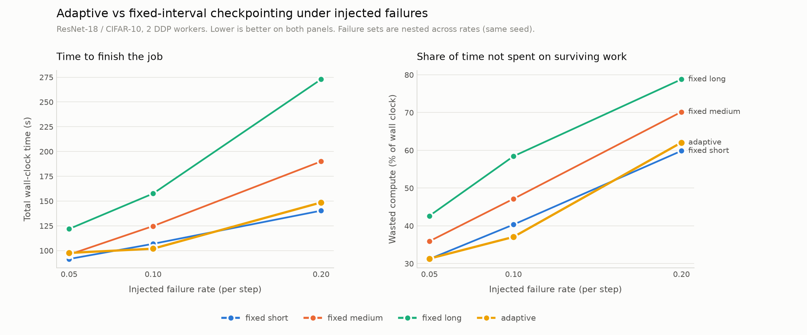

# CheckpointLab

Adaptive checkpointing and fault-tolerant recovery for distributed PyTorch training.

Distributed training jobs fail constantly — nodes crash, get preempted, or lose
the network. Most systems respond by either losing hours of compute or
checkpointing defensively and wasting it anyway. CheckpointLab injects
reproducible failures into real DDP training and derives the checkpoint interval
from measured checkpoint cost, observed failure rate and throughput, rather than
from a constant somebody guessed.

A controller spawns one process per rank, detects when one dies, tears down the
generation, finds the newest checkpoint that actually loads, and relaunches —
with no human in the loop.



## Quick start

```bash
python3 -m venv .venv
source .venv/bin/activate          # .venv\Scripts\activate on Windows
pip install -r requirements.txt

python training/train.py           # ResNet-18 on CIFAR-10, 2 DDP workers
```

Checkpointing is on by default (every 100 steps, into `results/checkpoints/`).
Kill the run with Ctrl+C and start it again with the same command — it resumes
from the last checkpoint instead of starting over.

```bash
python training/train.py --checkpoint-every 50     # save more often
python training/train.py --adaptive-checkpointing  # compute the interval
python training/train.py --async-checkpointing     # write off the training thread
python training/train.py --no-resume               # ignore existing checkpoints
```

### See a failure and recovery end to end

```bash
bash demo/demo.sh
```

A ~25 second run: training → injected worker failure → automatic detection →
checkpoint restore → resume → completion. Captured output is in
[`demo/demo_transcript.txt`](demo/demo_transcript.txt).

```
  !! FAILURE DETECTED  worker 1 exited 137 (last reported step 7)
     terminating generation 1 (survivors still up: [0])
     resuming from ckpt_step00000006.pt (global_step=6, epoch=0, step_in_epoch=6)
     relaunched as generation 2
     RECOVERED in 3.99s (lost 1 step(s) of work)

PASS — job completed after 1 automatic recovery(ies)
  final exit codes   {0: 0, 1: 0}
```

The demo is deterministic: the same seed injects the same failure, at step 7, on
worker 1, every run. Worker 1 is the victim deliberately, so you can watch the
controller tear down the *survivor* — rank 0 doesn't crash, it blocks in a
collective waiting for a peer that is never coming back.

## How it works

```
                    Controller (controller/recovery.py)
                           │
            ┌──────────────┴──────────────┐
            │                             │
      Failure injector              Metrics exporter
      (failures/)                   (metrics/ → Prometheus)
            │                             │
            ↓                             ↓
     ┌─────────────┐               Prometheus / Grafana
     │  Worker 0   │
     │ PyTorch DDP │──────┐
     └─────────────┘      │
                          ├──── ResNet-18 / CIFAR-10
     ┌─────────────┐      │
     │  Worker 1   │──────┘
     │ PyTorch DDP │
     └─────────────┘
            │
            ↓
     Checkpoint manager (checkpoint/)
            │
      ┌─────┴─────┐
      ↓           ↓
   Storage   Adaptive scheduler
```

**Checkpointing.** A checkpoint captures model weights, optimizer state,
dataloader position and per-rank RNG state. The RNG part is the one usually
missed: data augmentation draws from the global torch RNG, so a resumed run that
doesn't restore it sees different augmented images and drifts immediately. Writes
are atomic (temp file then `os.replace`), so a crash during a write can't leave a
truncated file that still looks loadable.

**Failure injection.** Whether a worker dies at step N is `sha256(seed:N)`, not a
sequential RNG draw. That keeps it reproducible even when a run resumes from a
checkpoint and replays steps, and stable across Python versions and platforms.

**Recovery.** Two detectors, because DDP fails in two shapes. A killed worker
exits and is caught immediately. The *survivors* usually don't die — they block
inside a collective waiting for a rank that isn't coming back, and gloo's default
timeout is 30 minutes. Every worker touches a heartbeat file, and a stale
heartbeat counts as a failure even when the process is alive.

**Adaptive scheduling.** The interval comes from Young's formula. With `d` the
checkpoint write cost and `M` the mean time between failures, expected wasted
compute as a fraction of useful compute is:

```
W(T) = d/T  +  T/(2M)  +  R/M
       writes  lost work  restarts
```

Minimising gives `T* = sqrt(2·d·M)`. Expensive checkpoints push the interval up,
frequent failures pull it down, and the square root means a 100× worse failure
rate only shortens the interval 10×. `R` shifts the curve but not its minimum —
slow restarts make failures more expensive without arguing for more frequent
checkpoints.

## Results

Adaptive scheduling against the best hand-tuned fixed interval, measured by share
of compute wasted. Three failure rates, 12 jobs, with 99.5% of every job's wall
clock attributed to a named cost:

| failure rate | adaptive | best fixed | verdict |
|---|---|---|---|
| 0.05 | 31.3% | 31.2% | tie, inside noise |
| 0.10 | **37.0%** | 40.3% | win — 12% less waste |
| 0.20 | 62.1% | 59.8% | loss |

It wins at moderate failure rates and loses when failures are very frequent,
where its MTBF estimate overshoots because replayed steps are counted as
exposure. What it delivers reliably is landing within noise of the best fixed
interval **without being told the failure rate** — where picking a medium or long
interval by hand costs 11–59% more wasted compute.

Wall clock swings up to 15% between identical runs, so wasted compute is the
headline metric and a 0.1pp gap is reported as a tie rather than a win.

Full data: [`results/benchmark_results.csv`](results/benchmark_results.csv).

### Other measured results

| | |
|---|---|
| **Resume correctness** | A killed-and-resumed run reproduces the uninterrupted loss curve to `0.0` absolute difference (tolerance `1e-5`), including replayed steps and an epoch boundary crossed after the resume |
| **Recovery latency** | ~3.5 s per incident, of which ~96% is worker process startup — interpreter, torch import, checkpoint load — not controller logic |
| **Async checkpointing** | Blocking per checkpoint drops from 435 ms to 8.7 ms (50×) for an 89.5 MB checkpoint, still bit-exact |
| **Elastic resumption** | A job crashed at 2 workers restarts at 3 and keeps converging, verified against a fresh-run control |

## Running the pieces

```bash
# correctness: does a resumed run match an uninterrupted one?
python checkpoint/verify.py
python checkpoint/verify.py --async-checkpointing

# are injected failures reproducible?
python failures/verify_reproducibility.py

# does the controller recover unattended?
python controller/recovery.py --failure-rate 0.05 --failure-seed 42

# does the scheduler react to the failure rate?
python checkpoint/verify_scheduler.py

# restart with a different worker count than crashed with
python controller/verify_elastic.py

# full benchmark: fixed vs adaptive across failure rates (~35 min)
python experiments/benchmark.py

# sync vs async checkpoint overhead
python checkpoint/bench_async.py
```

### Containers and monitoring

```bash
# two containers, one per DDP rank
docker compose -f docker/docker-compose.yml --profile train up

# crash/recovery loop inside a container
docker compose -f docker/docker-compose.yml --profile recover run --rm controller

# Prometheus + Grafana + metrics exporter
docker compose -f docker/docker-compose.yml --profile monitor up -d
open http://localhost:3000
```

Grafana renders throughput, checkpoint interval and recovery-phase breakdown
([example panels](docs/)). The exporter is a sidecar that re-reads each job's
JSONL logs at scrape time, because the workers are killed on purpose and can't
host a scrape target themselves. See [`docker/README.md`](docker/README.md).

## Tests

```bash
pytest                      # everything (~4 min)
pytest -m "not slow"        # fast tier only (~10 s)
```

236 tests. The fast tier covers estimators, checkpoint logic and the exporter;
the slow tier spawns real DDP subprocesses, kills them and verifies recovery.
GitHub Actions runs both on every push and pull request.

## Known limitations

- **Exact resume requires `--deterministic`**, which forces `num_workers=0`.
  DataLoader workers derive their RNG from the parent at iterator creation and
  prefetch eagerly, so their augmentation streams can't be restored from a
  checkpoint. Throughput runs should leave the flag off.
- **The scheduler's MTBF estimate overshoots under heavy failures.** Fired-step
  suppression means only never-executed steps can fail, so replayed steps aren't
  real exposure — but `M` counts all training time between failures. This is why
  adaptive loses at a 0.20 failure rate.
- **Recovery cost `R` lags by one cycle.** The controller records it only after a
  relaunched generation's first step, so a job with a single failure never sees a
  non-zero `R`.
- **Async checkpointing only helps when the interval exceeds the write time.**
  Below that the background writer stalls and it degenerates to
  sync-plus-clone-overhead — measurably worse than sync.
- **Elastic resumption is not bit-exact**, and can't be: changing the world size
  changes the effective batch size, so a different optimisation problem is being
  solved. Learning rate is not rescaled to compensate.
- **No cross-container supervision.** The controller supervises ranks with
  `Popen` and `killpg` on local PIDs, so it can't manage ranks in other
  containers. That needs a Docker-socket backend.
- **Containerized training is not bit-identical to bare metal** (~1e-2
  divergence), because the Linux and macOS torch builds reorder floating-point
  reductions. Determinism is a within-environment property.

## Repo structure

```
training/     model + distributed training loop
checkpoint/   save/restore, async writer, adaptive scheduler, verification
controller/   worker supervision and automatic recovery
failures/     seeded, reproducible failure injection
metrics/      cost accounting and Prometheus exporter
experiments/  benchmark suite comparing checkpoint strategies
tests/        fast unit tier + slow end-to-end tier
docker/       container images, compose stack, Grafana provisioning
demo/         30-second crash-and-recover demo
```

## Built with

PyTorch (DistributedDataParallel, gloo), ResNet-18 on CIFAR-10, Docker Compose,
Prometheus, Grafana, GitHub Actions, pytest, matplotlib.
